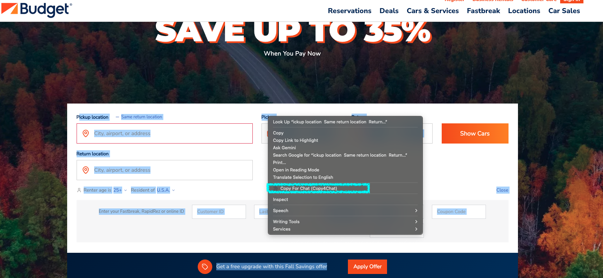

# Copy4Chat

Copies browser selections as structured text for LLMs, preserving visual and semantic relationships that plain-text copy drops.

**Status: v0.1 spike.** Built strictly to test whether structured copy outperforms `selection.toString()` on downstream agent tasks.

## Install

1. Open `chrome://extensions`, enable **Developer mode**, and click **Load unpacked** on this directory.
2. Select text on any page, right-click, and choose **Copy For Chat (Copy4Chat)**.


## Real-world example: Expedia

<p align="center">
  
</p>

The same selection, copied both ways.

<table>
<tr>
<th width="55%">Copy4Chat</th>
<th width="45%">Ordinary copy</th>
</tr>
<tr>
<td valign="top">

<pre>
┌─ Expedia logo ────────────────────────────────────┐
│ https://www.expedia.com/                          │
│ [ Shop travelShop travelShop travel ] ‹collapsed› │
│ [ USD• ]                                          │
│ [ AAlex$0.00 OneKeyCash ] ‹collapsed›             │
└───────────────────────────────────────────────────┘
┌─ The one place you go to go places ─────────────────────────────────────┐
│ ┌─────────────────────────────────────────────────────────────────────┐ │
│ │ ┌─────────────────────────────────────────────────────────────────┐ │ │
│ │ │ ┌─ Where to? ─────────────────────────────────────────────────┐ │ │ │
│ │ │ │ Where to?. Results available.                               │ │ │ │
│ │ │ │ [ San Francisco, California, United States of America____ ] │ │ │ │
│ │ │ └─────────────────────────────────────────────────────────────┘ │ │ │
│ │ │ ┌─ Dates ────────────────────────────────────────────┐          │ │ │
│ │ │ │ [ Tue, Oct 20 - Wed, Oct 21 ] ‹focused, collapsed› │          │ │ │
│ │ │ └────────────────────────────────────────────────────┘          │ │ │
│ │ │ ┌─ Travelers ─────────────────────────┐                         │ │ │
│ │ │ │ [ 2 travelers, 1 room ] ‹collapsed› │                         │ │ │
│ │ │ └─────────────────────────────────────┘                         │ │ │
│ │ │ [ Search ]                                                      │ │ │
│ │ └─────────────────────────────────────────────────────────────────┘ │ │
│ │ Add a flight to Bundle &amp; Save*                                      │ │
│ └─────────────────────────────────────────────────────────────────────┘ │
└─────────────────────────────────────────────────────────────────────────┘
Get more trip for less when you bundle flight and hotel together
Book now (https://www.expedia.com/deals/bundle-for-less)
#### Last-minute weekend deals
  Minimum 20% off deals for your next weekend getaway!
See all deals (https://www.expedia.com/clp/XtvM6jr)
</pre>

</td>
<td valign="top">

<pre>
Expedia logo

Shop travel

USD
•
United States
List your property
Support
Trips

A
Alex
$0.00 OneKeyCash
The one place you go to go places

Stays

Flights

Cars

Packages

Things to do

Cruises
Where to?
San Francisco, California, United States of America
DatesTue, Oct 20 - Wed, Oct 21
Travelers2 travelers, 1 room
Search

Add a flight to Bundle &amp; Save*


Packages under $699
Get more trip for less when you bundle flight and hotel together
Book now
Last-minute weekend deals
Minimum 20% off deals for your next weekend getaway!
See all deals
</pre>

</td>
</tr>
</table>

What survives on the left and not on the right:

- `San Francisco, California, United States of America` is the **value of the
  destination field**, not a line that happens to follow "Where to?".
- `DatesTue, Oct 20 - Wed, Oct 21` is a date picker holding a value, and it is
  `‹focused›` and `‹collapsed›` — live state that exists nowhere in the DOM text.
- `Search` is a button, not a word.
- Link targets survive on *Book now* and *See all deals*.

Rough edges are left in rather than cleaned up. They are open bugs, not
stylistic choices:

- `Shop travelShop travelShop travel` and `AAlex$0.00 OneKeyCash` — inline
  elements are being concatenated without separators.
- Three wrapper frames stack up before the search panel. Each holds something
  of its own, so the pure-wrapper trim does not fire, but it is still noise.
- `Where to?. Results available.` is a live region echoing its own label.

Account name and balance are replaced with a placeholder in both columns.

Expedia is an independent third party and is not affiliated with, sponsoring,
or endorsing Copy4Chat. Expedia and its associated trademarks belong to their
respective owners.

## Icon

`icons/icon.svg` is the source; the PNGs Chrome loads are generated from it:

```
./tools/make-icons.sh     # writes icons/icon{16,32,48,128}.png
```

Chrome itself is the rasteriser, so there is no ImageMagick or librsvg
dependency and the result matches what the browser will draw. Edit the SVG,
re-run the script, then reload the extension.

Sizes are the ones Chrome asks for: 16 and 32 for the context menu and
favicon slots, 48 for `chrome://extensions`, 128 for installation and the
Web Store listing.

## Architecture

```
context-menu click  (service worker — routing only, never sees page content)
      └─ chrome.scripting.executeScript  (activeTab; no host permissions)
            ├─ extract.js    selection → IR
            ├─ render.js     IR → text
            └─ clipboard.js  write, two paths
```

Nothing runs on pages until invoked via `activeTab` (no `<all_urls>` content script). The service worker only routes the click and never touches page content.

## Design Rules

- **Selection-only content.** Never expand the selection outward. Surrounding DOM is read only to annotate hierarchy, explicitly marked so agents can distinguish context from selection:
  ```
  ‹context: Checkout › Payment Form›

  Error
    Payment failed
    Card number is invalid
  ```
- **Emit what is visible, never more.** Respect visual presentation (`text-transform`, `::before`, masked passwords) over raw DOM strings. Icons count as visible content: an `<svg>`/`` is transcribed via its accessible name, because the glyph is what tells a sighted reader that `8` means stars.
- **Never lose to the baseline.** Anything an HTML→Markdown converter preserves — links, headings, list and record boundaries, real tables — we must preserve too. Our output should be a *superset* of the converter's, not an alternative to it.
- **Semantics → hierarchy → geometry.** HTML/ARIA wins first, then DOM nesting and sibling shape. Geometry never promotes relationships—it only vetoes them or fixes CSS-reordered reading order (`order`, `row-reverse`, absolute positioning).
- **Degrade to nesting.** Ambiguous structure falls back to nested lists rather than hallucinated tables. Only real `<table>` elements render as Markdown tables.

## Renderers

The extractor produces a renderer-agnostic IR, so output style is a swap, not a rewrite. Set `RENDERER` at the top of `src/content/main.js`.

- **`boxed`** (default) — visual-text. Frames the things whose frame carries meaning: forms, repeated records, side-by-side arrangements. Prose and headings stay Markdown. Output is wrapped in a ``` fence, without which a chat client's proportional font destroys the alignment on arrival.
- **`text`** — nested Markdown. Cheaper in tokens, and the thing `boxed` has to beat.

```
┌─ Welcome back ────────────────┐
│ Email address                 │
│ [ james@example.com____ ]     │
│ Password                      │
│ [ ••••••••••____ ]            │
│ ☑ Remember me                 │
│ [ Sign in ]                   │
│ ⚠ Incorrect email or password │
└───────────────────────────────┘
```

Framing is driven by the IR, not by guesswork: a group earns a frame when it directly holds controls or is one of a set of repeated records, and a run of records becomes columns only when the container's measured axis is `row`. Recording the arrangement is not a claim that the items are comparable — `pricing-cards.html` is the fixture that keeps that honest.

**Open question:** boxes roughly double the token count and models have seen far more Markdown than box art, so recognisability may cost comprehension. Score both renderers on the fixtures before treating the default as settled.

## Privacy

- **Unconditional masking:** `input[type=password]`, sensitive `autocomplete` attributes (`cc-number`, `cc-csc`, `one-time-code`, etc.), secret-like field names/labels, token patterns, and Luhn-valid card numbers—applied to both content and context labels.
- **Clean clipboard:** No footers, URLs, or attribution are appended to copied text. When masking occurs, a page toast notifies the user directly.

## Benchmark

**The control is not `selection.toString()`.** A chat client pastes by reading the clipboard's `text/html` flavour and converting it to Markdown, which gets links, headings, lists and real tables for free. That is the baseline users actually have, so that is the baseline to beat — score every fixture against Turndown + the GFM plugin. Any fixture the control also passes is measuring nothing; delete it rather than keep it as a comfortable win.

What a converter structurally *cannot* see, and where our value therefore lives: live interaction state, visual reading order under CSS reordering, visibility filtering, CSS-rendered text, and masking.

| Fixture | Role |
|---|---|
| `repo-cards.html` | **Regression.** Ordinary copy beat us on a real GitHub profile — links, record boundaries, icon-labelled counts. Must tie at minimum. |
| `kanban-reordered.html` | Differentiator: DOM order contradicts visual order, so the converter is *wrong*, not vague |
| `split-labels.html` | Differentiator: live `.value` / `selectedOptions` are invisible to a converter |
| `pricing-cards.html` | Negative test: must remain nested, not coerced into a table |
| `feature-matrix.html` | **At risk** — a GFM converter handles real tables, so this may no longer measure anything. Re-score, then likely delete. |

## Tests

```
node test/render-invariants.js          # geometry
node test/render-invariants.js --print  # geometry + rendered output
```

The boxed renderer holds one invariant, and the United regression was a
violation of it rather than a tuning problem:

> Every render operation returns a Rect — `{ lines, w }` with every line padded
> to exactly `w` display columns — and nothing downstream ever re-wraps it.

Wrapping is a property of text, so it happens once, when text becomes a Rect.
The earlier renderer returned bare string arrays of unknown width and wrapped
them inside the panel builder, which could word-wrap a nested box's border.
Budget flows downward: a frame at budget B renders its body at B-4, so a child
can never return wider than its parent allows. Horizontal composition is
attempted on finished rectangles and falls back to packing or stacking them
**unchanged** — a composed block is never reflowed.

The tests assert this rather than eyeballing it: nothing exceeds 80 columns,
every opening corner has a closing corner in the same *display* column (not
string index — they diverge under CJK), no orphaned border fragments, and
balanced verticals. `test/ir/*.json` are IR fixtures replayed through the same
checks; `united-search.json` is the page that broke it.

## Out of Scope (v0.1)

- **Shadow DOM** — requires `Selection.getComposedRanges()`.
- **Cross-frame selections** — execution targets a single frame.
- **Canvas apps** (Docs, Figma) — no underlying DOM text.
- **Virtualized lists** — only currently mounted DOM nodes are captured.
- **Automated eval runner** — fixtures are currently scored manually.
